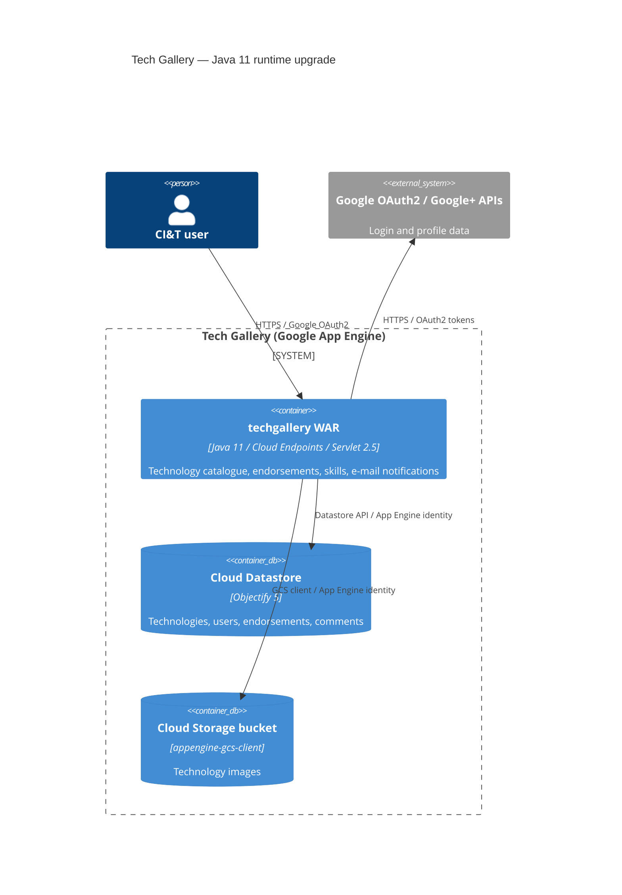

# 0001. Upgrade Tech Gallery runtime from Java 7 to Java 11

- **Status:** Proposed
- **Date:** 2026-09-24
- **ARB ticket:** TO BE CREATED
- **Authors:** Devin (on behalf of the Tech Gallery maintainers)
- **Owning team:** Tech Gallery (CI&T) — TBD, owner to confirm before ARB
- **Related ADRs:** none (first ADR in this repository)

## Context

Tech Gallery is a Google App Engine (Java) / Cloud Endpoints monolith. The Maven build
compiled with `source/target 1.7`, a compiler plugin (3.1) that forks `${JAVA_HOME}\bin\javac`,
`mockito-all 2.0.2-beta`, Jackson 2.2.3 and `javax.xml.bind.DatatypeConverter` (a Java EE module
removed from the JDK in Java 11, JEP 320). Java 7 is end-of-life and the codebase cannot be built
on a current JDK. The task is to make the application compile, test and package on JDK 11 without
changing its runtime behaviour or adopting JPMS.

ARB triggers: T7 (runtime / language major version upgrade: Java 7 -> Java 11). No other trigger
fired: no new service, data store, vendor, integration, auth or network change.

## Decision

We will build and target Java 11 (`maven-compiler-plugin 3.8.1`, `<release>11</release>`),
replace discontinued/incompatible build-time libraries (`mockito-all` -> `mockito-core 4.11.0`,
JUnit 4.13.2, Jackson 2.13.5, commons-io 2.7, surefire 2.22.2, war plugin 3.3.2,
frontend-maven-plugin 1.12.1) and replace the removed `javax.xml.bind.DatatypeConverter` with
`java.util.Base64`. The App Engine SDK version (1.9.27), Objectify, the Google API clients and the
deployment model stay unchanged; no `module-info.java` is introduced.

## Alternatives considered

| Alternative | Pros | Cons | Why rejected |
| --- | --- | --- | --- |
| Do nothing (stay on Java 7) | Zero change | Java 7 is EOL; cannot build on modern JDKs; unpatched toolchain | Blocks any further maintenance |
| Upgrade to Java 8 only | Smallest step; JAXB still in JDK | Also past public updates; would need a second migration soon | Insufficient longevity |
| Upgrade directly to Java 17/21 | Longest support horizon | App Engine SDK 1.9.x, Objectify 5 and the 2015-era Google clients are unverified on 17+; larger risk in one step | Out of scope for this task; can follow as a later ADR |
| Add `jaxb-api` + `jaxb-runtime` instead of `java.util.Base64` | No source change | Adds two runtime jars for a single base64 call | Unnecessary dependency |

## Architecture

No component, data store or external dependency is added or removed; only the runtime version
of the existing container changes.

## Non-functional requirements

| NFR | Target | How met |
| --- | --- | --- |
| Availability SLO | Unchanged — TBD, owner to confirm before ARB | Same App Engine deployment |
| p95 latency | Unchanged — TBD, owner to confirm before ARB | Same code paths; JIT improvements in Java 11 |
| RPO / RTO | Unchanged (Cloud Datastore managed) | No data model change |
| Peak load | Unchanged — TBD, owner to confirm before ARB | App Engine autoscaling unchanged |
| Scaling model | App Engine automatic scaling (unchanged) | No config change |
| Data retention | Unchanged | No data change |

## Security & compliance

- **Data classification:** internal employee profile/skill data — unchanged.
- **Encryption at rest:** Google-managed (Datastore / GCS) — unchanged.
- **Encryption in transit:** HTTPS — unchanged.
- **AuthN / AuthZ:** Google OAuth2 via Cloud Endpoints — unchanged.
- **Secrets:** OAuth client IDs in `Constants.java` — unchanged by this ADR.
- **Audit logging:** App Engine request logs — unchanged.
- **Data residency / regions:** unchanged.
- **Policy sections satisfied:** N/A — no infrastructure defined in this repository.
- **Threats considered:** dependency bumps remove known CVEs in jackson-databind 2.2.3, commons-io 2.4 and JUnit 4.12 (TemporaryFolder). Bower 1.5.2 (frontend) remains vulnerable and is out of scope.

## Cost

| Item | Assumption | Monthly estimate |
| --- | --- | --- |
| App Engine instances | Same instance class and count | $0 delta |
| **Total** | | $0 delta |

## Operations

- **On-call rotation:** unchanged — TBD, owner to confirm before ARB.
- **Runbook:** README.md (build/deploy instructions updated for JDK 11).
- **Dashboards / alarms:** unchanged.
- **Rollback plan:** revert the PR; the previous WAR remains deployable via `appengine:update` with the prior version id.
- **Migration / cut-over plan:** deploy as a new App Engine version, verify `/_ah/api/explorer`, then set default.

## Policy exceptions requested

| Rule | Resource | Justification | Compensating control | Expiry |
| --- | --- | --- | --- | --- |
| none | | | | |

## Consequences

- Positive: builds on a supported JDK; removes reliance on removed JDK modules; modern test stack.
- Negative / risks: App Engine SDK 1.9.27 / Objectify 5 were only validated at build and unit-test
  level on JDK 11; the App Engine Java 11 runtime requires further verification before production
  deployment. `java.util.Base64.getMimeDecoder()` is used to keep the whitespace-tolerant behaviour
  of `DatatypeConverter.parseBase64Binary`.
- Follow-ups: verify deployment on the App Engine Java 11 runtime; consider a later ADR for
  Java 17+ and for replacing the obsolete node 0.10 / bower frontend toolchain.

## Open questions

- Confirm owning team, SLOs and on-call rotation before ARB.
- Confirm the target App Engine runtime (`java11`) and any `appengine-web.xml` changes required for it.
